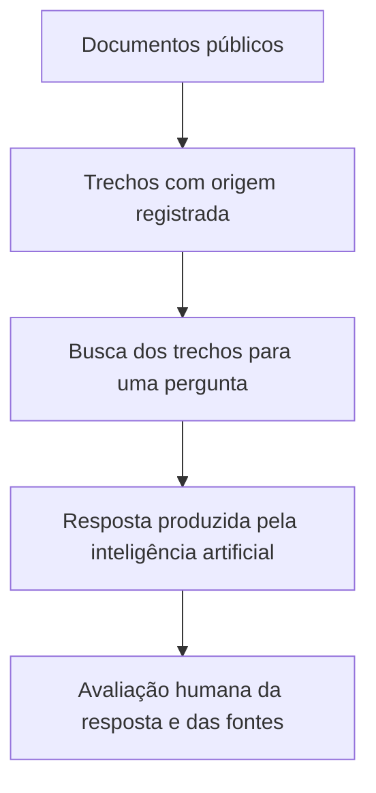

# Entenda o projeto

[Voltar ao início](../README.md)

## Que problema queremos estudar?

Uma resposta pode trazer uma fonte correta e perder a condição que define quando a regra vale. Em serviços bancários, essa condição pode ser um gasto mínimo, um tipo de cartão ou um prazo.

Queremos descobrir como a organização dos documentos afeta a busca e a resposta. Também queremos identificar quando um filtro retira uma informação necessária.

## Como funciona o caminho da informação?

Yago verifica as fontes e prepara as perguntas antes de produzir as respostas. Ela registra o endereço de cada documento e conserva uma cópia da data de coleta.

## O que significa organizar os documentos?

Yago descreve o que cada documento trata. Essa descrição pode incluir o cartão, o público, o canal de atendimento e o período da regra.

Essas descrições são chamadas de **metadados**. Pense nelas como etiquetas que ajudam a localizar e interpretar um documento.

Uma etiqueta incorreta pode atrapalhar a busca e o filtro. Uma regra que vale para todos os cartões precisa ter esse alcance registrado.

## O que vamos comparar?

O estudo compara seis formas de buscar e responder, chamadas de configurações. A tabela está no [início do projeto](../README.md#o-que-o-estudo-compara).

Três perguntas orientam as comparações:

| Pergunta do estudo | Comparação |
|---|---|
| Uma descrição mais completa melhora a resposta? | B com A |
| O filtro melhora a resposta e preserva as fontes necessárias? | C com B |
| Título, seção e tipo de documento ajudam além de produto e público? | B com Bp |

L ajuda a entender o desempenho da busca por palavras. S mostra como o modelo responde quando recebe a pergunta sem documentos.

## Quem faz o trabalho?

Yago é o único pesquisador. Ele coleta e revisa documentos, prepara referências, descreve os trechos, executa modelos, avalia respostas e analisa resultados em etapas separadas.

As referências ficam congeladas antes das respostas. O formulário oculta configuração e semente, com ordem aleatória. Uma amostra é reavaliada depois. O conhecimento prévio de Yago continua presente; o estudo declara a ausência de avaliação independente.

[Consulte o adendo individual](protocolo-individual.md).

## O que é uma referência de avaliação?

É o registro do que uma pergunta exige. Esse registro reúne a regra, suas condições, as fontes e a ação esperada.

No texto científico, ele se chama **dossiê**. Para uma pergunta incompleta, pode exigir um pedido de esclarecimento. Quando falta informação na coleção, pode exigir que a resposta reconheça essa falta.

## Como sabemos se uma resposta é adequada?

Yago verifica se a resposta atende a todos os requisitos da referência. Também verificam se os valores e as condições foram preservados.

O estudo separa duas verificações:

- **Suficiência:** há informação bastante para responder?
- **Aplicabilidade:** a informação vale para a situação descrita na pergunta?

Uma regra pode estar completa e se referir a outro cartão. Uma regra do cartão certo pode depender de um gasto que a pessoa ainda não atingiu.

## Por que começar com um piloto?

O piloto é um teste inicial de 60 perguntas. Ele permite revisar os procedimentos e medir o esforço pessoal.

As perguntas pertencem a cinco grupos: resposta direta, condição, exceção, ambiguidade e falta de informação na coleção. Há quatro perguntas de cada grupo por banco.

Cada resposta recebe uma avaliação de Yago. O piloto tem 450 avaliações iniciais e 90 reavaliações após no mínimo 14 dias. Isso exige cerca de 27 horas a três minutos por marcação. O teste técnico de fidelidade, quando necessário, é adicional.

## Quantas perguntas entram na etapa final?

A quantidade depende das regras encontradas, das famílias independentes e dos recursos disponíveis.

Uma **família** reúne perguntas que dependem da mesma regra e da mesma evidência. Fazer muitas versões da mesma pergunta não cria novas famílias independentes.

O plano individual considera inicialmente até 120 perguntas finais, a decidir pelo piloto. São 900 avaliações iniciais e 180 reavaliações, aproximadamente 54 horas de marcação. A análise é exploratória; a precisão depende das famílias e da amostra disponíveis.

## O que fica registrado?

- Fontes, endereços, datas e condições de coleta.
- Descrições dos documentos e revisões individuais.
- Perguntas, famílias e referências de avaliação.
- Versões do código e dos modelos.
- Fontes encontradas, fontes retiradas e respostas.
- Primeiras avaliações, reavaliações, justificativas e cálculos.
- Problemas encontrados e mudanças no plano.

## O que ainda precisa acontecer?

Selecionar os bancos, validar os modelos e executar o piloto. Yago define a amostra final e registra o plano antes da etapa final.

[Veja o plano de trabalho](roadmap.md).
